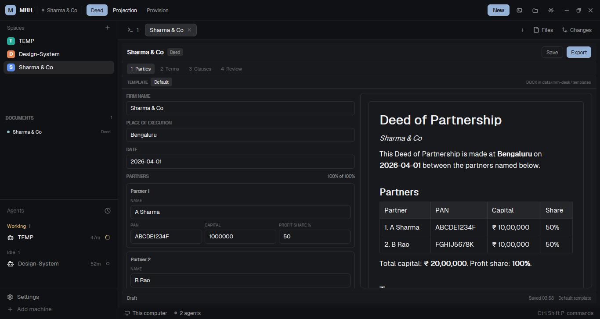

# MRH Desk

A drafting desk for a small firm: one Herdr window where a partnership deed, a projection or a tax provision is filled from a schema, previewed as a document, and exported as DOCX or XLSX (PDF on demand). The left rail is the matter (Herdr spaces), the saved documents and the agents; the middle is the document tab; the right side of each document is the live draft preview. The layout has no colours of its own — it draws with the current theme — and all data lives under the Herdr app home.



## What you see

At zoom 1, top to bottom:

- **Top bar — 48 px**, `chrome`, one pixel `border` underneath, window drag:
  - 24 px `accent` tile, 6 px radius, "M" in 13 px semibold `accent_foreground`; "MRH" in 12.5 px semibold `foreground`.
  - A 6 px space-status dot and the active space's name in 11.5 px `muted`, truncated at 230 px.
  - Three mode pills, 26 px high, 10 px side padding: **Deed**, **Projection**, **Provision**. The selected one is `accent` with `accent_foreground` text; the others are `muted` and get a `hover` wash.
  - Right: a 26 px solid `accent` **New** button; a terminal icon, a folder icon, a gear icon (26 px each, `muted` glyph, `hover` background); and the window minimize/maximize/close buttons when `window().buttons` is true (Windows/Linux).
  - On macOS the bar starts at 78 px so the traffic lights stay clear; the traffic lights are at `[12, 16]`.
- **Sidebar — 268 px**, `chrome`, full height:
  - **Spaces** (weight 1, min 90 px): Herdr's spaces list, unchanged.
  - **Documents** (weight 1, min 100 px): the saved documents for the shown space — a 6 px mode dot (deed `ansi6`, projection `ansi4`, provision `ansi3`), the document title in 11 px `foreground`, and the mode short name in 9 px `dim`. Empty text: "No documents in this space."
  - **Agents** (weight 1, min 90 px): Herdr's agents list, unchanged.
  - **Footer — 69 px**: Herdr's Settings and Add machine rows.
- **Tabs bar — 42 px**, `chrome`, one pixel `border` underneath, window drag: the shown space's Herdr tabs (29 px pills, 7 px radius, 12.8 px text; active `raised` with `foreground` and a `border` outline; working spinner, blocked/done dot, close × on the active tab), + (opens Herdr's new-menu at 250×512), Files and Changes (26 px; the shown one `selected`). The cloned tabs mod draws no window buttons and adds no macOS light padding.
- **Work area** — 8 px padding and 8 px gaps. The active tab's panes are cards: `background`, 1 px `border`, 10 px radius, `accent` focus outline. A single pane has no header; splits get the shipped `pane` header (28 px, top, revealed on hover) with program icon, title, folder, status and split/zoom/close.
- **Desk**, inside the document tab:
  - **Header — 44 px**: the document title (firm/client/entity) in 13.5 px semibold, a small mode chip (Deed/Projection/Provision), then Save, Export, and (after an export) PDF and Open. A busy label appears while the engine runs. Below 840 px wide, a Form/Preview toggle replaces the side-by-side view.
  - **Steps — 32 px**: numbered pills from the schema (Parties, Terms, Clauses, Review for a deed; Inputs, Assumptions, Review for a projection or provision). The current step is `selected`; steps with validation errors get a 5 px `blocked` dot.
  - **Template bar — 28 px** (deeds only): "TEMPLATE", a "Default" pill and one pill per `*.docx` in the templates folder; the selected pill is `selected`. Right side hint: "DOCX in data/mrh-desk/templates".
  - **Form**: labels 9.5 px semibold `dim`; inputs 32 px high with `surface` fill and 1 px `border` (red when invalid); textareas with an 8 px inset; money, percent, date and number fields are text inputs with validation; partner rows are `surface` cards with "Partner N", Remove, a full-width name and a row of PAN / Capital / Profit share; + Add partner and + Add clause rows. Profit share shows "N% of 100%" and turns red on mismatch after the first validation.
  - **Preview**: a `background` pane with a `surface` page card (max 640 px wide, 24 px padding, 6 px radius, 1 px `border`) rendering semantic HTML: headings, paragraphs, tables and the signature block. It updates as you type; it is not the final Word page.
  - **Footer — 24 px**: validation or "Draft"/"Ready" on the left, "Saved HH:MM" and the template name on the right.
- **Panel — 360 px** (min 280, max 900), hidden by default: Herdr's Files and Changes cards in a `panel-body` stack, toggled from the tabs bar.
- **Status bar — 28 px**: Herdr's machine, branch, agent count, "needs you" count and the palette hint.

All colours are theme tokens: `canvas`, `chrome`, `background`, `surface`, `raised`, `selected`, `border`, `foreground`, `muted`, `dim`, `accent`, `accent_foreground`, `blocked`, `working`, `done`, `ansi3`, `ansi4`, `ansi6`. The layout sets no `theme`, `colors`, `font` or `font_size`; the person's theme and settings decide.

## How it behaves

- **Modes** choose what the next **New** document is; they do not convert an open document. A document's type is fixed by the tab it was created in and is shown as the chip in the desk header. The top bar remembers the last mode in `localStorage("mrh.mode")`.
- **New** generates a document id, then runs `tab.new {name: <Deed|Projection|Provision>, space, mod: "mrh-desk", props: {doc, mode, space}}`. The new tab is the document; fill it, save it, export it. A tab is named after the mode until the desk renames it to the document title on Next or Export (only while the tab still has the mode's short name).
- **Documents** reads `data/mrh-desk/docs/<spaceId>/*/spec.json` every 4 s and when the shown space changes. Click a row: if a tab in the space already has that title, it is selected; otherwise a new tab is opened with the same `doc` id, so the saved spec comes back. Renaming a tab away from the title can make the list open a duplicate.
- **Desk state**: the first copy reads `shared("mrh.spec.<doc>")`; if absent it reads `spec.json` from the data folder in a `cx.spawn` and rebuilds its inputs. Every change marks the document dirty; a 2 s timer, blur or Enter writes `shared` and the spec file. `updated` is an ISO timestamp. Closing the tab writes the spec once more.
- **Steps**: Next validates every field and blocks on the first error in the current step; Back and the step pills move without validating. Export validates all steps, jumps to the first error and refuses to run.
- **Validation**: required text, PAN pattern `^[A-Z]{5}[0-9]{4}[A-Z]$` when filled, amounts (money, optional commas/₹), percentages 0–100, dates `YYYY-MM-DD`, years 1–10, at least two partners, at least one clause, and partner profit shares summing to 100.
- **Preview**: `previews.js` builds semantic HTML from the schema values with Indian digit grouping (`₹ 20,00,000`, `50%`). It is local, instant and CSS-free; the exported file is the authority. The preview pane scrolls.
- **Export**: saves the spec, then runs the bundled generator:
  `uv run --script <appHome>/mods/mrh-desk/tools/mrh_doc.py build --mode <mode> --spec <spec> --out <out> [--template <docx>]`.
  The generator prints one JSON object; the desk shows a success toast, adds PDF and Open buttons, and stores the returned file paths. Failures show the generator's error text in the footer and as an error toast.
- **PDF**: a separate `topdf.ps1` call uses Word (docx) or Excel (xlsx) COM with the document opened read-only, exports PDF, closes the document and quits the application. The PDF appears beside the source, and the desk remembers it.
- **Open**: `Start-Process` on Windows, `open` on macOS, `xdg-open` on Linux; the last exported file is opened in its default application.
- **Templates** (deeds): the template bar lists `.docx` files in `data/mrh-desk/templates`, refreshed every 8 s. Choosing one stores its file name in the spec; Export passes it as `--template`. The generator renders it with docxtpl (Jinja): `{{ firm }}`, `{{ p.name }}`, `{{ total_capital|rupees }}`, `{{ p.share|pct }}`, and autoescapes values. Projection and provision exports always use the built-in workbook builder.
- **Docs list, tabs, spaces, agents, Files/Changes**: Herdr's own mods behave as in the main layout — click, rename (F2), drag tabs, wheel to switch, right-click menus, per-space panel memory, agent focus, Files previews and Changes commits.
- **Agent statuses** are drawn by Herdr's shipped mods, not by this layout: working spinner, blocked "Needs you" pill, done dot, idle plain; the space dot and tab dots use `working`/`blocked`/`done`. The top bar adds only the active space's status dot.
- **Window**: the top bar and the tabs bar are window-drag areas; their buttons stop the press so a click does not start a drag. Double-clicking the bar maximizes.

## Built from

```
root  column, titlebar "none", traffic_lights [12,16], preview layouts/MRHDesk.svg,
      background canvas, terminal_padding [14,12], no theme/colors/fonts
├─ topbar  block, 48 px, window_drag, { mod: "mrh-topbar" }
└─ body    row, resizable false, divider 1 border
   ├─ sidebar  column, 268 px, min 44, max 480, background chrome, resizable false
   │  ├─ sidebar-lists  column
   │  │  ├─ spaces  block, weight 1, min 90, { mod: "spaces" }
   │  │  ├─ docs    block, weight 1, min 100, { mod: "mrh-docs" }
   │  │  └─ agents  block, weight 1, min 90, { mod: "agents" }
   │  └─ sidebar-footer  block, 69 px, { mod: "workspace-chrome", props: { footer: true } }
   └─ work  column, resizable false
      ├─ tabs  block, 42 px, window_drag, { mod: "mrh-tabs" }
      ├─ work-body  row, padding 8, gap 8
      │  ├─ main   block, { tab: "active", pane: … }
      │  └─ panel  column, 360 px, min 280, max 900, hidden
      │     └─ panel-body  stack active "files" { files, changes }
      └─ status  block, 28 px, { mod: "workspace-status" }
```

The pane object: `{ gap: 8, radius: 10, background: "background", lone: false, border: { width: 1, color: "border" }, focus: { width: 1, color: "accent" }, header: { content: { mod: "pane" }, height: 28, position: "top", reveal: "hover" } }`.

- **`mods/mrh-topbar/`** (`place: none`): the monogram, active space, mode pills, New, terminal, data folder, settings and window buttons. Uses `theme`, `spaces`, `run`, `window`, `exec`, `appHome`, `fs.mkdir`; its seven 16×16 SVGs are drawn at 15 px.
- **`mods/mrh-docs/`** (`place: none`): reads the shown space's saved specs with `fs.readdir`/`fs.readFile`, renders titles, and fills the gap by selecting or opening a tab. Timer 4 s.
- **`mods/mrh-tabs/`** (`place: none`): a copy of Herdr's shipped `tabs` mod with the window-button block and the macOS light padding removed. It keeps `syncPanel`, the per-space panel memory, tab drag/reorder, rename, wheel switching, the right-click menu, Files/Changes and the new-menu overlay.
- **`mods/mrh-desk/`** (`place: none`):
  - `main.js`: the desk. Reads its `{doc, mode, space}` props with **`props()`** (not the `init` argument), loads `shared` then `spec.json`, builds `InputState`/`TextareaState` per schema field and per repeatable row, validates, saves, exports, makes PDFs and opens files.
  - `schemas.js`: the three document families — fields, defaults, steps and validation metadata. Edit labels/keys/defaults here.
  - `previews.js`: semantic HTML for the draft preview, Indian number formatting and the review summary.
  - `tools/mrh_doc.py`: PEP 723 script with `docxtpl` and `openpyxl`. Default deed builder (A4, Times New Roman 11, parties, capital table, clauses, signatures, footer), projection workbook (Assumptions + Projection with formulas and print setup), provision workbook (Inputs + Computation), and custom `.docx` rendering via docxtpl with `rupees`, `inr`, `pct` filters and autoescape. Prints `{ok, files}` or `{ok: false, errors}`.
  - `tools/topdf.ps1`: Word/Excel COM PDF export (read-only, silent, quits in `finally`).
- **Shipped mods used:** `spaces`, `agents`, `pane`, `files`, `changes`, `workspace-chrome` (footer), `workspace-status`, `new-menu` (the +), `menu` (tab right-click), `picker` (terminal picker from Herdr's own header is not used here).
- **`herdr` functions called:** `theme`, `props`, `spaces`, `focused`, `run`, `exec`, `appHome`, `notify`, `shared`, `setShared`, `window`, `fs/promises`.
- **Commands called:** `tab.new`, `tab.select`, `tab.rename`, `tab.close`, `tab.move`, `tab.next/prev`, `pane.split/zoom/close`, `pane.focus`, `layout.show/hide/select`, `space.select`, `agent.focus`, `app.settings`, `window.minimize/maximize/close`.
- **Programs:** the desk runs `uv` (Python generator) on Export, `powershell` for PDFs and opening files, and the shipped Files/Changes mods run PowerShell/`sh`/`git`. The generator reads only the spec and optional template; it writes only under the document's `out/` folder.
- **Storage:** `~/.config/herdr-app/data/mrh-desk/` — `docs/<spaceId>/<docId>/spec.json`, `docs/<spaceId>/<docId>/out/*.docx|xlsx|pdf`, and `templates/*.docx`. Spec JSON is `{version, mode, values, template, updated}`. The top bar's folder button creates and opens this root.
- **Art:** the seven top-bar SVGs; the monogram/wordmark are text; `layouts/MRHDesk.svg` is the picture Settings shows for this layout (a schematic, not a live capture).

## Watch out

- **Props come from `props()`.** A mod's `init(p)` argument is not guaranteed to hold the pane props; read `props()` in `init` (or first). The desk and the logos in this layout do that. `props()` returns `{doc, mode, space}` for a document tab.
- **The tabs mod is a clone.** Herdr's shipped `tabs` mod is replaced whole on every start; `mrh-tabs` is a copy so it can drop the window buttons and the macOS light padding. It will not receive Herdr's future tab fixes. Do not add window buttons back: the top bar owns them.
- **Node ids are load-bearing:** `sidebar`, `panel` and `panel-body` are read by the shipped spaces/agents/tabs mods. Keep them, and keep the tabs clone as the tabs block.
- **Use `entry.isDirectory()`, not `entry.isFile()`.** The Herdr `fs/promises` `Dirent` interface only exposes `isDirectory()`; filtering templates with `isFile()` throws and the list stays empty.
- **Inputs are host objects.** `InputState.new`/`TextareaState.new` belong in `init` or an event handler, never in `render`. Creating them again after loading a spec file inside `cx.spawn` works, but release the old states first (`state.release?.()`); this build does.
- **The preview is not Word.** `TextView.html` ignores CSS; the draft is semantic HTML with the UI font. Tables are real but narrow preview columns wrap long labels (the projection uses "Dep."). The exported DOCX/PDF is the authority; do not promise page fidelity.
- **App-home storage is hidden.** Backups are the person's job: copy `~/.config/herdr-app/data/mrh-desk`. The top bar's folder button opens it. Documents are not in the matter folder beside the client's files.
- **The docs list matches by title.** The desk renames a tab to the document title only when the tab still carries the mode's short name. If a tab is renamed by hand, clicking the same title in Documents can open a second copy of the same spec; both write the same file (last save wins).
- **The engine needs `uv` and Python 3.11+.** The first `uv run --script` downloads `docxtpl` and `openpyxl` from PyPI and caches them. After that it is local. If the machine is offline, pre-warm once with `uv run --script mods/mrh-desk/tools/mrh_doc.py build --help`.
- **PDF needs Word or Excel installed.** `topdf.ps1` uses COM, not LibreOffice. A modal Office dialog (a recovery pane, a protected-view prompt) blocks the export; close it. `exec` has a 30 s cap, and Word's first conversion is around 8 s on this machine.
- **No custom XLSX templates.** Projection and provision always use the built-in workbook builder. Custom templates apply to deeds only and must be `.docx` in `data/mrh-desk/templates`, with Jinja tags; values are autoescaped (`&` survives), and the filters are `rupees`, `inr`, `pct`.
- **Starter content is not advice.** The default clauses and the projection/provision arithmetic are working examples. Replace the clauses with the firm's approved text, and check the tax regime, surcharge thresholds, MAT and credits against the actual law and the client's computation.
- **Sizes:** 268 px sidebar + 360 px panel leave about 620 px for a document in a 1280 px window; the desk switches to a Form/Preview toggle below 840 px. The panel is hidden by default and remembered per space by the tabs mod.
- **macOS:** the layout hides the system title bar and puts the traffic lights at `[12,16]`; the top bar pads 78 px. The cloned tabs bar sits below it and has no light padding. The top bar draws minimize/maximize/close only when `window().buttons` is true (Windows/Linux).
- **No custom keys.** The layout ships no `keys.json`; Herdr's defaults apply. The mode pills and New are pointer controls. `ctrl-shift-l` switches layouts and returns to the person's other layout.
- **A spec in `shared` wins over the file.** If a file is edited by hand while the app still holds the shared copy for that doc id, the desk keeps the shared values until the shared entry is gone (app reset) or the doc id changes. Use the desk to edit specs.

## Done when

- `herdr-app check` passes for `mods/mrh-topbar`, `mods/mrh-tabs`, `mods/mrh-docs` and `mods/mrh-desk`.
- `herdr-app do layout.switch --name MRHDesk` shows the top bar with the three modes and New, the sidebar with Spaces/Documents/Agents/Settings, the tabs bar with Files/Changes, a document card and the status bar; `herdr-app status` reports no errors.
- **New → Deed**: the desk opens on Parties with Firm, Place, Date and two partner cards. Export refuses and jumps to the first missing field. Fill Firm `Sharma & Co`, Place `Bengaluru`, Date `2026-04-01`, two partners with PANs, capital and 50% shares, and Business. Export writes a DOCX under `data/mrh-desk/docs/<space>/<doc>/out/` and shows PDF and Open; PDF writes a PDF beside it; Open opens the last file.
- **New → Projection** with a client, base revenue and margins exports an XLSX with Assumptions and Projection sheets whose Year 4 revenue equals Year 1 × (1 + growth)³; the preview table matches the same numbers.
- **New → Provision** exports an XLSX whose Computation sheet shows taxable income, normal tax, MAT, tax payable and net payable, and whose preview shows the same figures.
- **Templates**: drop a DOCX with `{{ firm }}` and `{{ p.name }}` into `data/mrh-desk/templates`; within 8 s a pill appears. Select it and export; the produced DOCX contains the template's text and the rendered names, and `&` in a firm name survives.
- **Documents**: after a save, the doc appears in the sidebar; click it and the same tab is selected (or the saved spec opens); after closing the tab, clicking the document reopens it with its values and title.
- **Persistence**: close and reopen the app; the desk tab (if kept) or a reopened document restores its values from `shared`/`spec.json`; the Documents list repopulates.
- **Data folder**: the folder icon opens `data/mrh-desk`; the Templates folder is inside it.
